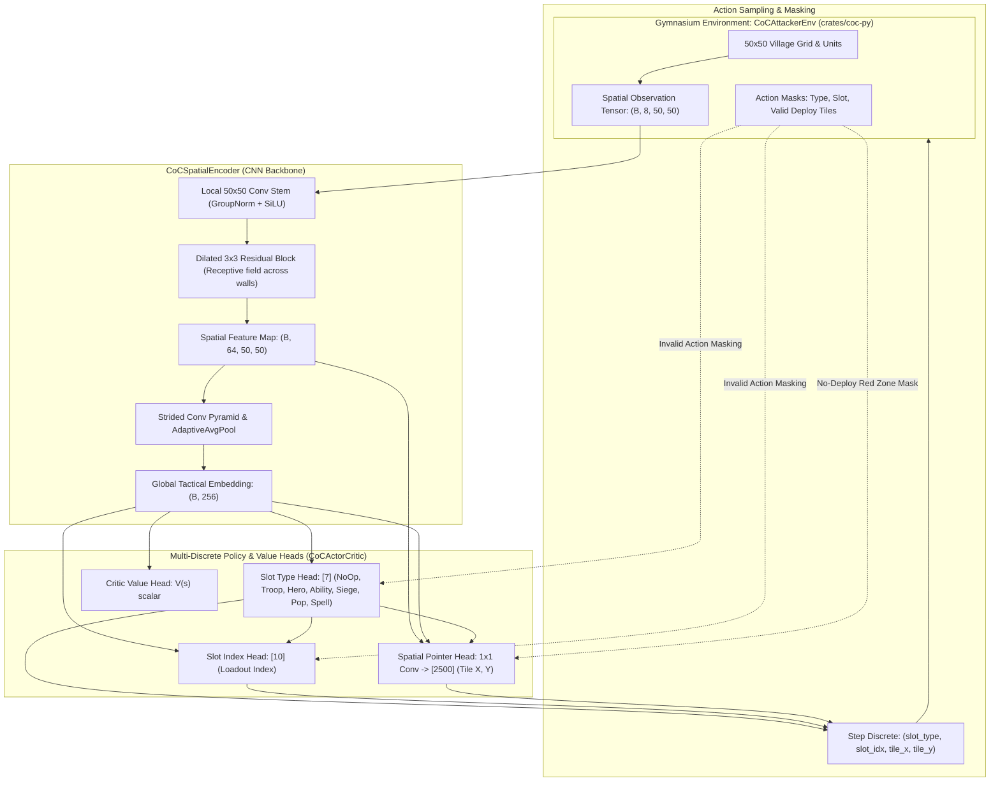

# CoC-AI: Deep Reinforcement Learning Sandbox & Educational AI Curriculum

[](python/labs/)
[](https://www.rust-lang.org/)
[](https://webassembly.org/)
[](https://pytorch.org/)
[](https://gymnasium.farama.org/)
[](https://react.dev/)

An educational playground and hands-on curriculum that uses the rich, combinatorial world of **Clash of Clans** as a compelling **pretext to learn core AI and Deep Reinforcement Learning (Deep RL) concepts from scratch** — while actively leveraging modern AI coding tools and automated verifiers to accelerate the learning journey.

---

## 🎓 The Educational Mission: Learning AI Concepts Using AI

While Clash of Clans is a beloved, globally recognized tactical strategy game, it is used here as an **ideal sandbox for studying modern AI systems engineering**: an environment with imperfect information, continuous time (10 Hz ticks), discrete spatial grid deployment (50 × 50), line-of-sight pathfinding, and complex combinatorial action spaces.

**The primary purpose of this repository is not merely to build a game bot, but to serve as a hands-on learning vehicle for mastering Deep RL from first principles:**

1. **Learning AI by Building It Hands-On**:
   Instead of studying reinforcement learning math purely in the abstract, learners construct the entire pipeline: from fundamental tensor operations and CUDA acceleration up to spatial convolutional backbones, factorized multi-discrete policy heads, advantage estimation, and clipped surrogate loss updates.
2. **Learning AI *Using* AI**:
   This project is explicitly structured to be explored in tandem with AI coding assistants (such as Gemini, Claude, or ChatGPT) acting as interactive tutors and pair programmers. Each lab module includes automated test harnesses (`verify_bootcamp.py`, `verify_labs.py`) with strict shape checks and gradient verifiers, creating a tight feedback loop: read the concept, implement the layer, ask your AI mentor to critique or explain edge cases, and verify results instantly on your GPU.
3. **End-to-End Systems & Software Architecture**:
   Real-world AI goes far beyond isolated Python scripts. Learners see how high-throughput systems code (written in **Rust** for deterministic combat simulation) connects to Python via **PyO3/ABI3**, executes parallel rollouts across CPU threads with **Rayon**, and compiles to **WebAssembly** for instant in-browser interactive visualization.

---

## 📚 The Guided Curriculum

The repository includes a two-stage hands-on educational curriculum located in `python/`:

```text
 ┌─────────────────────────────────────────────────────────────┐
 │        STAGE 1: Pure PyTorch Bootcamp (6 Modules)           │
 │   Tensors, Shapes, Convolutions, Categorical Distributions  │
 └──────────────────────────────┬──────────────────────────────┘
                                │
                                ▼
 ┌─────────────────────────────────────────────────────────────┐
 │        STAGE 2: The 4-Stage Deep RL Lab Workbook            │
 │   Spatial CNN ➔ Factorized Policy ➔ GAE ➔ GPU PPO Update    │
 └──────────────────────────────┬──────────────────────────────┘
                                │
                                ▼
 ┌─────────────────────────────────────────────────────────────┐
 │        STAGE 3: Co-Evolution & Interactive Simulation       │
 │   Defender Base Evolution ➔ Real-Time Web Telemetry Studio  │
 └─────────────────────────────────────────────────────────────┘
```

### 1. Pure PyTorch Bootcamp (`python/pytorch_bootcamp/`)
*Zero game complexity required!* A gentle, self-contained ramp from beginner to proficient with PyTorch and CUDA:
* **Module 1**: Tensors, shapes, dimension slicing, and CUDA device transfers.
* **Module 2**: Autograd computation graphs, forward passes, MSE loss, and `loss.backward()`.
* **Module 3**: Linear layers, non-linear activations (ReLU, SiLU), and multi-layer perceptrons.
* **Module 4**: Spatial 2D convolutions (`Conv2d`), padding, receptive fields, and feature pooling.
* **Module 5**: Multi-head outputs and joint loss backpropagation.
* **Module 6**: Discrete action sampling using `torch.distributions.Categorical` and log-probabilities.
* *Run Verifier*: `.venv/bin/python python/pytorch_bootcamp/verify_bootcamp.py`

### 2. Guided Hands-On Deep RL Workbook (`python/labs/student_lab.py`)
A guided 4-stage laboratory where learners implement the neural policy for Town Hall 18 combat:
* **Lab 1: Spatial CNN Backbone (`CoCSpatialEncoder`)** — Transforming an `(8, 50, 50)` grid into a high-resolution feature map and a 256-D global tactical embedding.
* **Lab 2: Factorized Policy & Invalid-Action Masking (`CoCActorCritic`)** — Coordinating action type, loadout slot, and a 1x1 spatial pointer head while dynamically suppressing illegal drops with `-∞` logit masks.
* **Lab 3: Reward Shaping & Generalized Advantage Estimation (GAE)** — Designing dense milestone rewards and computing temporal-difference advantages.
* **Lab 4: GPU PPO Update Loop (`ppo_update_step`)** — Coding the clipped surrogate objective, value loss, entropy bonus, gradient clipping, and optimizer step on GPU.
* *Run Verifier*: `.venv/bin/python python/verify_labs.py`
* *Reference Implementation*: A fully documented reference solution is provided in `python/labs/reference_solution.py`.

---

## 🎯 High-Level Project Goals

1. **Educational AI Sandbox**:
   Provide an intuitive, visual, and highly rewarding framework for learning modern Deep RL, PyTorch, and game AI architecture.
2. **Autonomous Tactical Combat via Deep RL**:
   Train AI agents to master the deep combinatorial complexity of attacks: funneling, phase-separated deployments, tanking, spell drop timing, and hero ability sequencing.
3. **High-Throughput Deterministic Simulation**:
   A deterministic, tick-based combat engine written in **Rust** running at thousands of ticks per second, compiled to **PyO3/Rayon** for parallel GPU training rollouts and to **WebAssembly** for client-side browser execution.
4. **Data-Grounded Town Hall 18 Mechanics**:
   Directly incorporates extracted, decoded game logic tables (`coc_dumps/logic/*.csv`) covering stats, speeds, ranges, projectiles, hero equipment, pets, and crafted defenses.
5. **Co-Evolutionary Village Layout Defense**:
   Pair the attacker RL policy with an evolutionary genetic layout mutator (`CoCDefenderEvolution`) to generate anti-3-star base designs optimized against learned AI attacking strategies.
6. **Interactive Visual Studio**:
   A modern React + TypeScript browser interface featuring both 2.5D isometric and 2D tactical canvas views, army composition editors, live battle replays, and a dedicated AI Training Studio console for real-time tensor inspection and GPU monitoring.

---

## 🧠 AI & Deep Reinforcement Learning Architecture

The AI attacker is framed as a Markov Decision Process (MDP) and trained using **Clipped Proximal Policy Optimization (PPO)** with **Generalized Advantage Estimation (GAE)** and invalid-action logit masking.



### 1. Spatial Observation Tensor (`8 x 50 x 50`)

The agent receives a multi-channel spatial state representation preserving exact grid geometry:

| Channel | Representation | Description |
| :---: | :--- | :--- |
| **0** | **Building HP** | Normalized remaining HP `[0..1]` of all defending structures. |
| **1** | **Defense DPS Threat** | Normalized DPS threat heatmap radiating from active defense structures. |
| **2** | **Town Hall 18 Mask** | Binary mask indicating the exact footprint and state of the Town Hall. |
| **3** | **Wall HP** | Normalized HP of defending walls `[0..1]`. |
| **4** | **No-Deploy Red Zone** | Binary mask marking the red perimeter where troop deployment is illegal. |
| **5** | **Ground Troop HP Density** | Normalized live HP density of deployed friendly ground units. |
| **6** | **Air Troop HP Density** | Normalized live HP density of deployed friendly air units. |
| **7** | **Active Spell Zones** | Active area-of-effect zones (Rage, Heal, Freeze, Jump, Invisibility). |

### 2. Neural Network Architecture (`CoCActorCritic`)

* **Spatial CNN Backbone (`CoCSpatialEncoder`)**:
  * **Local Geometric Stem**: 2-layer convolution with `GroupNorm` and `SiLU` keeping full 50x50 resolution without batch-normalization drift.
  * **Dilated Residual Block**: Dilated 3 × 3 convolutions expand the receptive field across multi-tile wall compartments and dead zones without downsampling.
  * **Global Tactical Pyramid**: Strided convolutions with adaptive average pooling generate a compact 256-dimensional global tactical state embedding.
* **Factorized Multi-Discrete Control Heads**:
  * **`slot_type_head` (7 logits)**: Selects action category (`NoOp`, `DeployTroop`, `DeployHero`, `HeroAbility`, `DeploySiege`, `PopSiege`, `CastSpell`).
  * **`slot_idx_head` (10 logits)**: Selects which loadout slot to deploy, conditioned on the chosen slot category.
  * **Spatial Pointer Head (2,500 logits)**: Conditions the 50x50 spatial feature map on the global embedding and selected action type, outputting deployment target logits for every tile on the map.
* **Invalid-Action Masking**:
  * Dynamically sets logits of illegal actions to `-∞` prior to softmax sampling (e.g. preventing troop drops inside red zones, using exhausted slots, or triggering already-activated hero equipment).
* **Critic Head**:
  * Linear-SiLU MLP mapping the 256-D tactical embedding to a scalar state-value estimate `V(s)`.

### 3. Reward Shaping & Optimization

* **Destruction Reward**: Step-by-step differential reward for base damage percentage (`R_dmg = Δdamage × 1.0`).
* **Milestone Bonuses**: Substantial bonuses for key tactical achievements (+20 for 1st star, +30 for Town Hall kill, +50 for 100% 3-star wipeout).
* **PPO Training**: Clipped surrogate objective with Generalized Advantage Estimation (λ = 0.95, γ = 0.99), entropy regularization, and gradient clipping.

---

## 🏛️ Simulation Engine Architecture

```text
crates/
├── coc-data/     # Ground-truth entity catalogs, balance tables, VillageLayout & ArmyLoadout specs
├── coc-engine/   # Deterministic 10 Hz combat loop, A* pathfinding, line-of-sight targeting, projectiles
├── coc-wasm/     # WebAssembly bridge (wasm-bindgen) for client-side browser execution
└── coc-py/       # High-performance PyO3 C-extension exposing Gymnasium bindings & Rayon parallel evaluation
```

* **Deterministic Step Loop**: Advanced at 10 Hz (0.1 s per tick) with discrete event resolution.
* **A\* Pathfinding & Wall Breaking**: Custom grid pathfinder with cost-weighted wall penetration for ground troops, direct line targeting for air units, and jump/earthquake modifiers.
* **TH18 Combat Entities**: Accurate simulation of Barbarian King, Archer Queen, Grand Warden, Royal Champion, Minion Prince, and Dragon Duke with active Hero Equipment (Giant Gauntlet, Spiky Ball, Eternal Tome, etc.) and Pets.

---

## 💻 Tech Stack

* **Core Engine**: Rust (2021 edition), `serde`, `serde_json`, `wasm-bindgen`, `PyO3`, `rayon`.
* **Deep Learning**: Python 3.11+, PyTorch (with CUDA acceleration), Gymnasium, NumPy, FastAPI, Uvicorn.
* **Frontend**: React 18, TypeScript, Vite, HTML5 Canvas (Isometric 2.5D & 2D rendering), Tailwind/CSS3, Lucide Icons.

---

## 📁 Repository Structure

```text
.
├── Cargo.toml                # Rust workspace configuration
├── crates/
│   ├── coc-data/             # Catalog data, entity specs, building footprints, presets
│   ├── coc-engine/           # Combat simulation, collision masks, grid pathfinding
│   ├── coc-wasm/             # WebAssembly bindings consumed by web/
│   └── coc-py/               # PyO3 Python bindings for Gymnasium RL
├── python/
│   ├── coc_rl/               # Gymnasium environments (CoCAttackerEnv) & layout mutators
│   ├── labs/                 # Guided PyTorch Deep RL workbook & reference implementation
│   ├── pytorch_bootcamp/     # GPU verification exercises and verification suite
│   ├── train_ai.py           # CLI PPO training pipeline & Rayon evaluation benchmark
│   ├── verify_labs.py        # Automated CUDA shape and tensor verifier
│   └── server.py             # FastAPI backend for the Web AI Training Studio
├── coc_dumps/                # Decoded CSV logic extracted from live TH18 client
│   ├── logic/                # Combat balance tables (buildings, characters, heroes, spells...)
│   └── extract_coc_csv.py    # Extraction utility for updating game data
├── docs/                     # Behavioral specifications for all 176 TH18 combat entities
├── scripts/                  # Utility scripts (asset fetching, CSV logic audit)
└── web/                      # React + TypeScript + Vite web application
    ├── public/assets/        # Sprites, unit portraits, fonts
    └── src/
        ├── canvas/           # Isometric & top-down Canvas renderers
        ├── components/       # Army builder, layout inspector, AI studio console
        └── wasm-pkg/         # Generated WebAssembly binary package
```

---

## 🚀 Getting Started

### 1. Prerequisites

* **Rust & Cargo**: [Install Rust](https://rustup.rs/) (v1.75+)
* **wasm-pack**: `cargo install wasm-pack`
* **Node.js**: v18+ and `npm`
* **Python**: 3.11+ with PyTorch and CUDA support
* **Maturin**: `pip install maturin`

### 2. Build the Simulation Engine

```bash
# Run deterministic Rust engine tests
cargo test -p coc-engine

# Build WebAssembly package for the frontend
wasm-pack build crates/coc-wasm --target web --out-dir ../../web/src/wasm-pkg

# Build the native Python extension into your virtual environment
maturin develop --release -m crates/coc-py/Cargo.toml
```

### 3. Verify & Train the RL Agent

```bash
# Run the automated PyTorch RL shape & CUDA tensor verifier
python python/verify_labs.py

# Launch CLI PPO training against Town Hall 18
python python/train_ai.py --train-ppo --episodes 100 --device cuda
```

### 4. Launch the Web Visual Sandbox & AI Studio

```bash
# Start the Python AI Studio backend server (port 8000)
python python/server.py

# In another terminal, start the Vite development server
cd web
npm install
npm run dev
```

Visit `http://localhost:5173` to explore the interactive canvas sandbox, test attack strategies, and observe live training telemetry.

---

## 📜 License & Disclaimers

This project is an open-source educational and research initiative exploring Deep Reinforcement Learning in multi-agent real-time strategy environments. Clash of Clans and its related assets are trademarks of Supercell Oy. This project is not affiliated with, endorsed, or sponsored by Supercell.
