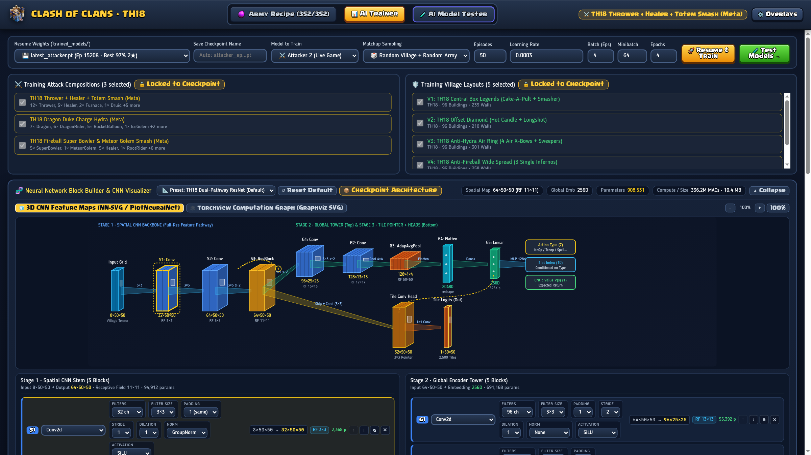
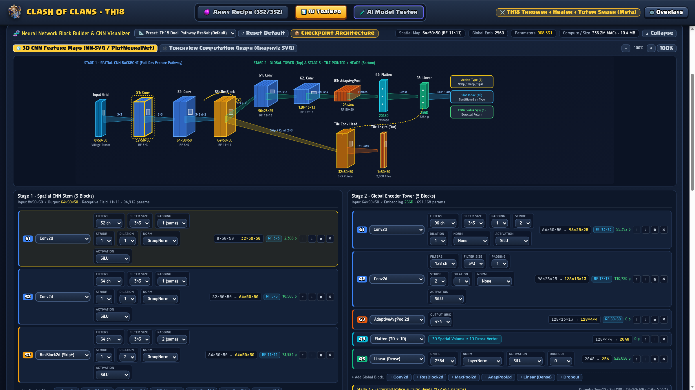
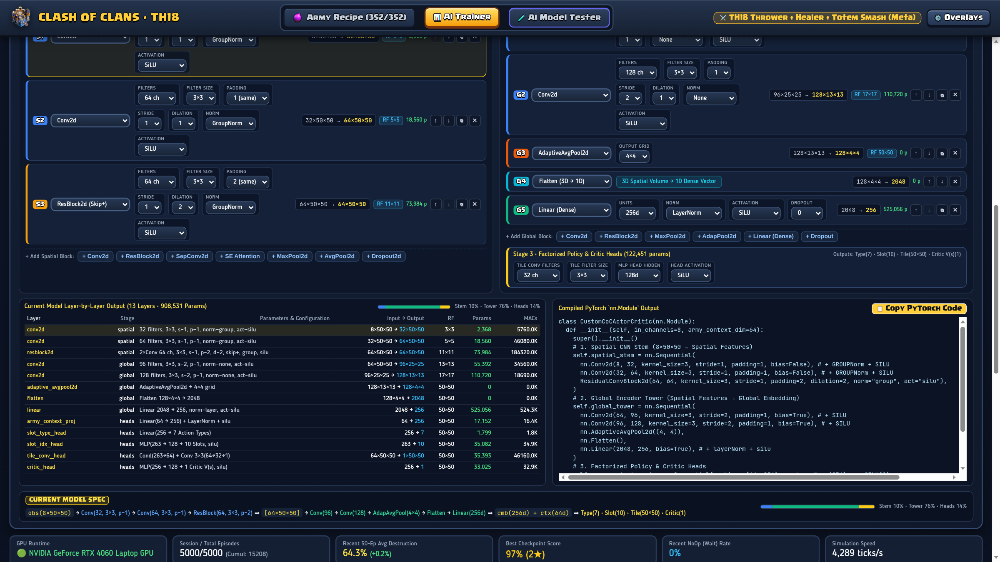
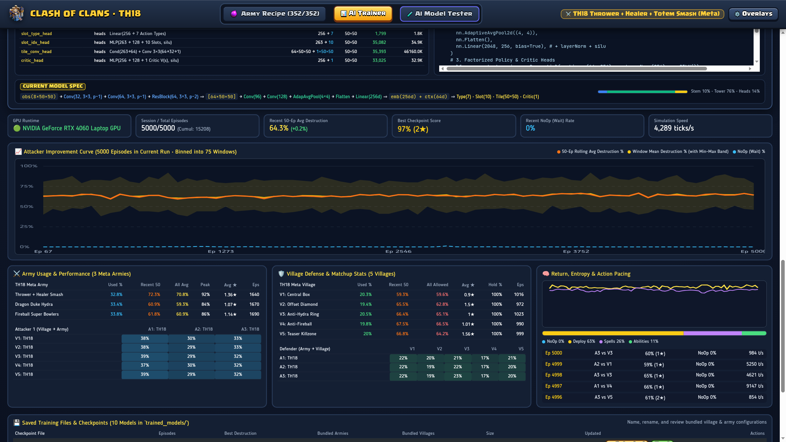
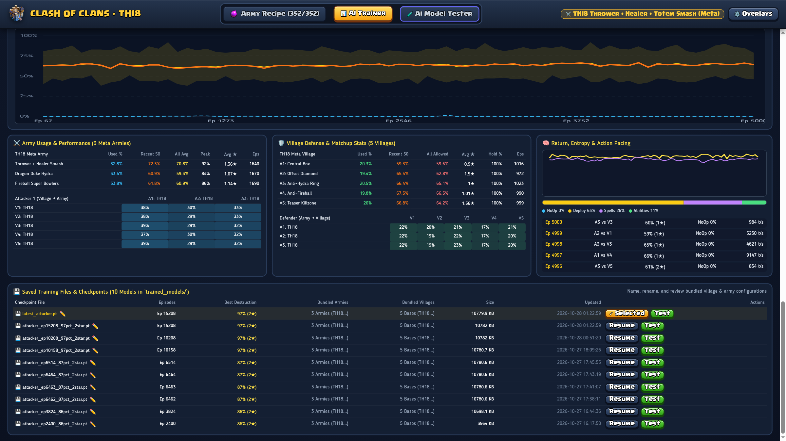
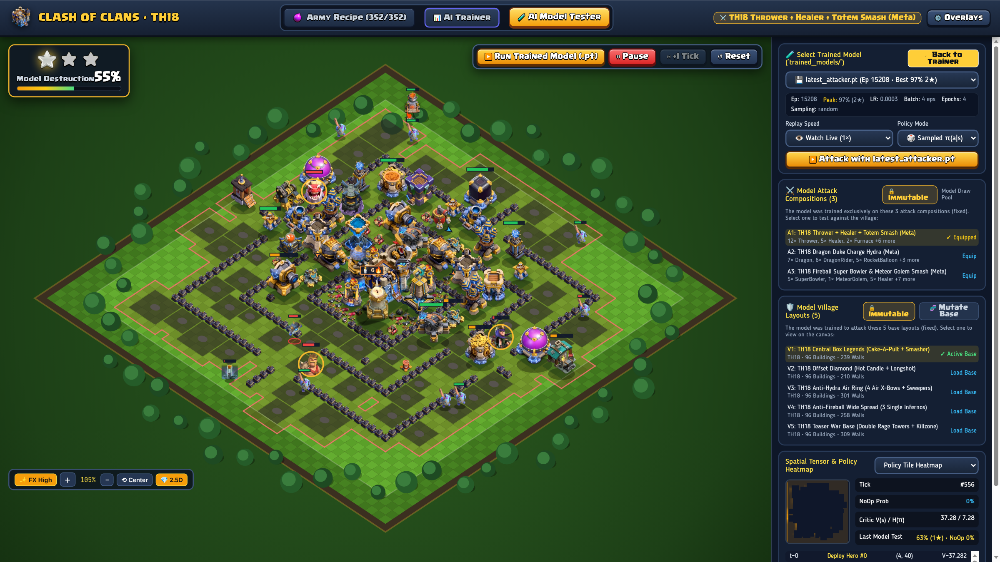
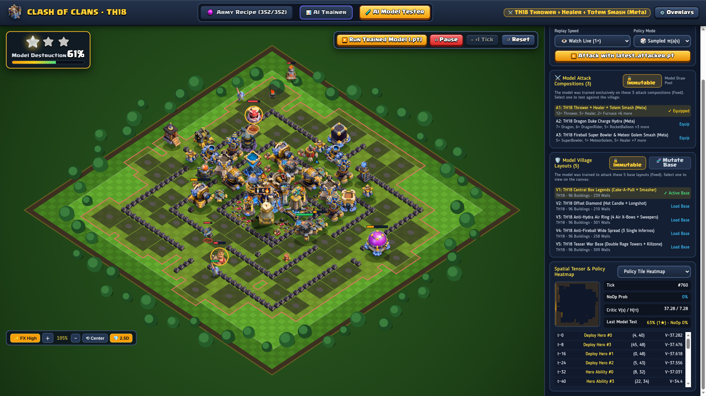

# CoC-AI: Learning Deep Reinforcement Learning with Clash of Clans

[](learning/rl_labs/)
[](https://pytorch.org/)
[](https://www.rust-lang.org/)
[](https://react.dev/)

A personal, hands-on educational project using **Clash of Clans** as a fun, visual playground to learn and experiment with modern **Artificial Intelligence**, **PyTorch**, and **Deep Reinforcement Learning (RL)** from first principles.

---

## 💡 Why This Project?

Instead of studying machine learning through dry math or toy datasets (like MNIST or CartPole), this repository uses a well-known strategy game as a **pretext to learn real-world AI concepts**:

* **Learning by doing**: Building neural networks, training loops, and reinforcement learning algorithms from scratch.
* **Learning AI *with* AI**: Using modern AI coding assistants as interactive mentors and pair-programmers, supported by automated verification scripts to validate ideas and code along the way.
* **A rich playground**: Clash of Clans offers fascinating challenges for an AI — spatial map awareness, timing troop drops, managing hero abilities, and optimizing for 3-star attacks.

---

## 🧠 High-Level AI Concepts Explored

Without getting bogged down in complex equations, the project covers fundamental building blocks of modern AI:

1. **PyTorch & GPU Fundamentals**:
   * Understanding tensors, computation graphs, and autograd.
   * Leveraging CUDA GPU acceleration for training neural networks.
2. **Spatial Perception with CNNs**:
   * Treating the 50×50 village grid like an image (representing defenses, walls, and troops across spatial layers).
   * Using Convolutional Neural Networks (CNNs) so the AI can "read the base" and spot vulnerable compartments.
3. **Decision Making via Actor-Critic & PPO**:
   * **The Actor (Policy)**: Decides *what* action to take (deploy a troop, use a hero ability, drop a spell) and *where* on the map to target.
   * **The Critic (Value)**: Evaluates how well an attack is currently going.
   * **PPO (Proximal Policy Optimization)**: A popular, stable reinforcement learning algorithm that updates the AI's strategy based on attack outcomes and star ratings.
4. **Action Masking**:
   * Preventing the AI from making illegal moves (like dropping ground troops inside the defender's red zone or using an ability twice).
5. **Simulation & Systems**:
   * Why fast simulation matters: training an RL agent requires thousands of attacks. A lightweight, deterministic simulator in Rust lets the AI learn rapidly before visualizing attacks in the browser.

---

## 🖥️ AI Studio & Real-Time Analytics

The web-based **AI Studio** (`web/src/ai/`) connects directly to the PyTorch CUDA backend (`python/ai_server.py`) and Rust combat simulation core, providing an interactive environment for real-time model training, architecture exploration, and combat visualization.


<p align="center"><em>AI Studio Trainer Dashboard with live GPU metrics, model modes, sampling schemes, and hyperparameter controls.</em></p>

### 1. Neural Network Architecture Visualizer & Block Builder
Interactive visual exploration of the Town Hall 18 Dual-Pathway ResNet actor-critic network:
* **3D Feature Map Pipeline**: Traces the 10×50×50 village grid observation through the spatial stem (Conv2D, GroupNorm, SiLU, dilated ResBlocks) and global pooling tower into factorized policy and value heads.
* **Architecture Metrics**: Live calculations of receptive field coverage (11×11 spatial, 50×50 global), parameter counts (908k parameters), compute requirements (336M MACs), and memory footprints.
* **Interactive Tuning**: On-the-fly adjustment of layer types, channel dimensions, kernel sizes, dilation, and normalization, with automatic PyTorch `nn.Module` code generation.


<p align="center"><em>Dual-Pathway ResNet feature map pipeline, receptive field tracking, and parameter breakdown.</em></p>


<p align="center"><em>Interactive block tuning with live PyTorch code generation and receptive field calculation.</em></p>

### 2. PPO Training Dashboard & Performance Analytics
Real-time reinforcement learning telemetry powered by local CUDA GPU acceleration:
* **Attacker Improvement Curve**: Tracks destruction percentage over episodes, complete with 50-episode rolling averages, min–max performance envelopes, and wait/action ratios.
* **GPU Speed & Throughput**: Monitoring simulation throughput (3,800+ combat ticks/s), episode cadence, and peak destruction scores (97% 2★).
* **Action Pacing & Entropy**: Telemetry for troop drops, spell placements, hero abilities, policy entropy, and value function loss.


<p align="center"><em>Attacker improvement curve across 15,000+ episodes, showing rolling 50-episode average and destruction performance.</em></p>

### 3. Meta Matchup Analytics & Checkpoint Management
Performance breakdowns across attacking armies and village layouts:
* **Matchup Statistics**: Tracks empirical usage rates, recent 50-episode average destruction, overall averages, peak scores, and star rates across the 3 Town Hall 18 meta army compositions and 5 village layouts.
* **Checkpoint Management**: Direct management, renaming, and inspection of trained `.pt` weights in `trained_models/`.


<p align="center"><em>Multi-agent meta matchup matrix, army usage rates, village hold rates, and saved checkpoints.</em></p>

### 4. Village Model Tester & Spatial Perception Sandbox
Interactive 2.5D battlefield for testing and validating trained checkpoints:
* **Combat Rollout Replay**: Watch live model rollouts at 1×, 5× fast-forward, or instant execution on Town Hall 18 bases with full particle FX and damage telemetry.
* **Tactical Overlays**: Live visualization of defensive attack ranges, danger/threat heatmaps, and deployment red-zones.
* **Spatial Observation Tensor Inspector**: Real-time rendering of the 14 CNN input feature channels (troops, defenses, walls, resource structures, pathfinding masks) showing exactly what the neural network "sees" during combat.


<p align="center"><em>2.5D isometric combat sandbox with active model deployment, tactical range rings, and threat heatmaps.</em></p>


<p align="center"><em>14-channel spatial observation tensor inspector, policy action probability distribution, and value function estimation.</em></p>

---

## 📚 Hands-on Learning Path

The repository is organized into simple, self-contained stages:

* **Level 1 — PyTorch Warmup** (`learning/pytorch_bootcamp/`):
  Short, zero-complexity exercises covering pure PyTorch basics (tensors, layers, loss functions, and action sampling).
  ```bash
  python learning/pytorch_bootcamp/verify_bootcamp.py
  ```

* **Level 2 — Guided Deep RL Labs** (`learning/rl_labs/`):
  A 4-step hands-on workbook where you build the AI attacker step by step (CNN map encoder, actor-critic policy, reward calculations, and PPO update loop).
  ```bash
  python learning/rl_labs/verify_labs.py
  ```

* **Level 3 — Visual Web Sandbox & AI Studio** (`web/`, `python/`):
  An interactive React and Canvas interface with separated **Game** (`web/src/game/`) and **AI Studio** (`web/src/ai/`) workspaces.

---

## 🚀 Quickstart

### 1. Run the Python Labs & Verifiers

```bash
# Verify the PyTorch basics
python learning/pytorch_bootcamp/verify_bootcamp.py

# Verify the Deep RL exercises
python learning/rl_labs/verify_labs.py

# Run a quick training experiment
python python/train_ai.py --train-ppo --episodes 20
```

### 2. Run the Interactive Web Sandbox & AI Studio

```bash
# Start the AI backend server
python python/ai_server.py

# In another terminal, run the web UI
cd web
npm install
npm run dev
```

Open `http://localhost:5173` in your browser to view the interactive village sandbox.

---

## 📜 Note

This is an educational, non-commercial learning project. Clash of Clans and its game assets are trademarks of Supercell Oy.
