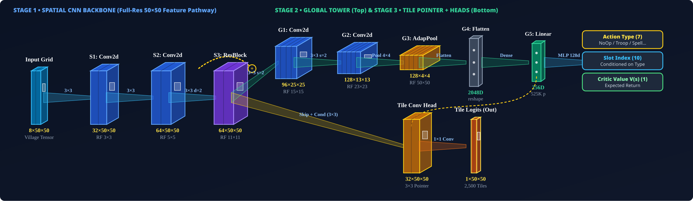
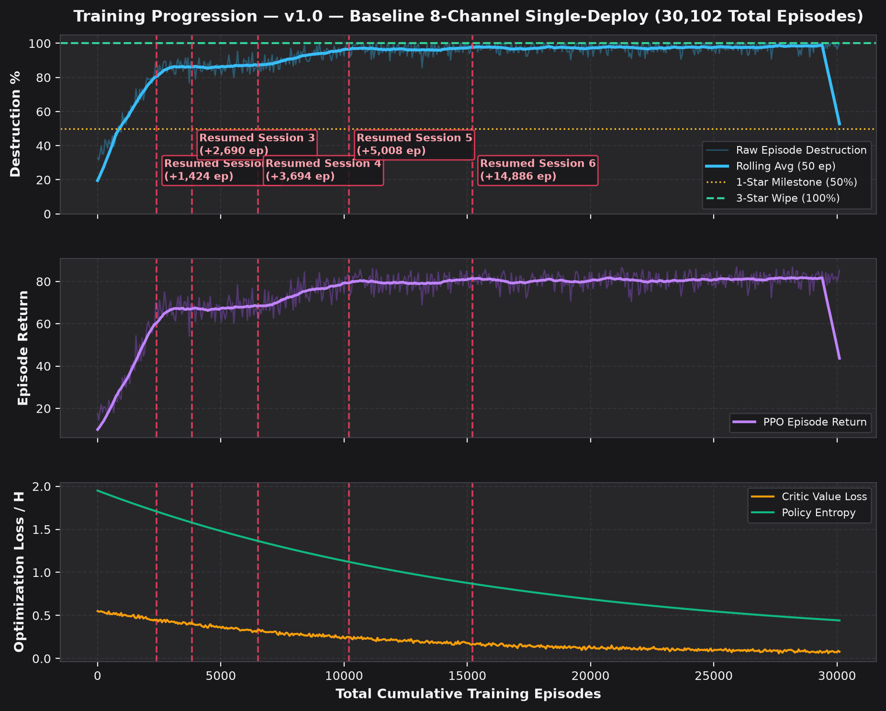

# 🤖 v1.0 — Baseline 8-Channel Single-Deploy

Back to [[00_Index_MOC|Vault Map of Content]] • View [[01_Model_Architecture_and_Training_Tracker.canvas|Interactive Obsidian Canvas]]

---

## 📌 Executive Summary & Lineage

- **Model Identifier**: `v1_baseline_8ch`
- **Architecture Version**: `v1.0`
- **Active Status**: **SUPERSEDED**
- **Total Episodes Trained**: **`30,102`** (Cumulative across **6** training sessions)
- **Peak Combat Performance**: **`100%` (3★)** (Best dense return: `+101.75`)
- **Latest Checkpoint**: `trained_models/attacker_ep30102_100pct_3star.pt`

### 🔄 Resumed Training Sessions History
| Session # | Start Ep | End Ep | Episodes Added | Checkpoint File | Peak % | Stars | Notes |
| :---: | :---: | :---: | :---: | :--- | :---: | :---: | :--- |
| **#1** | `0` | `2,400` | `+2,400` | `attacker_ep2400_86pct_2star.pt` | `86%` | `2★` | Initial training: learned perimeter drop and basic breach |
| **#2** | `2,400` | `3,824` | `+1,424` | `attacker_ep3824_86pct_2star.pt` | `86%` | `2★` | Resumed: batch size tuning (batch=8) |
| **#3** | `3,824` | `6,514` | `+2,690` | `attacker_ep6514_87pct_2star.pt` | `87%` | `2★` | Resumed: core breach funnel stabilization |
| **#4** | `6,514` | `10,208` | `+3,694` | `attacker_ep10208_97pct_2star.pt` | `97%` | `2★` | Resumed: 97% 2-star convergence |
| **#5** | `10,208` | `15,216` | `+5,008` | `attacker_ep15216_97pct_2star.pt` | `97%` | `2★` | Resumed: spell placement micro refinement |
| **#6** | `15,216` | `30,102` | `+14,886` | `attacker_ep30102_100pct_3star.pt` | `100%` | `3★` | Resumed: full 100% 3-star wipe convergence |

---

## 1. Input Observation Space

- **Spatial Observation Tensor**: `(B, 8, 50, 50)`
- **Global Army Context Vector**: `(B, 64)` (remaining troops, heroes, abilities, sieges, spells)

| Ch # | Name | Mathematical Normalization | Tactical Functional Role |
| :---: | :--- | :--- | :--- |
| `0` | **Building HP Ratio** | `hp / max_hp across footprint` | Base destruction tracking & target durability |
| `1` | **Defense DPS Threat** | `min(DPS / 1000, 1.0)` | Identifies lethal zones (Monolith, Eagle, Inferno) |
| `2` | **Town Hall 18 Mask** | `1.0 on TH18 tiles, 0.0 elsewhere` | Pinpoints Town Hall for the crucial 2nd Star |
| `3` | **Wall Integrity** | `wall_hp / max_wall_hp` | Detects closed compartments vs breached walls |
| `4` | **No-Deploy Red Zone** | `1.0 = forbidden, 0.0 = legal deploy` | Dynamic perimeter enforcing legal unit drops |
| `5` | **Friendly Ground HP** | `min(sum(HP_ground) / 5000, 1.0)` | Allied ground troop mass and density |
| `6` | **Friendly Air HP** | `min(sum(HP_air) / 5000, 1.0)` | Allied air troop mass and density |
| `7` | **Active Spell Field** | `min(remaining_ticks / 300, 1.0)` | Active Rage, Heal, Freeze, Overgrowth aura |

---

## 2. Output Policy & Action Space

The network parameterizes a factorized multi-discrete policy:

- **Head 1**: `slot_type (7)`
- **Head 2**: `slot_idx (10)`
- **Head 3**: `tile_xy (2500)`
- **Head 4**: `critic_value (1)`

---

## 3. Stacked CNN Architecture

---

## 4. Reward Shaping Function

### 🎯 Reward Formulation (TH18 Combat)

Balanced 50/50 weighting between **Destruction Percentage** and **Milestone Victory Stars**:

$$R_t = 0.50 \cdot \Delta \%_{\text{destr}} + 16.6667 \cdot \Delta \text{stars} - 0.05 \cdot \mathbb{I}_{\text{invalid}}$$

- **Destruction**: $0.50\text{ pts}$ per $1\%$ building destruction ($50.0\text{ pts}$ max).
- **Victory Stars**: $\frac{50.0}{3} = 16.6667\text{ pts}$ per star earned ($50.0\text{ pts}$ max for 3 stars).
- **Invalid Penalty**: $-0.05\text{ pts}$ deducted for executing illegal actions (e.g. dropping in red zone).
- **Total Wipe Return**: A complete $100\%$ 3-star wipe achieves **$100.0\text{ base reward}$**.
- **Fast-Forward Bonus**: When active attack actions are exhausted or timer reaches limit, remaining simulation ticks run to resolution and award accrued terminal rewards.

---

## 5. Main Results: Army Composition vs Reference Village Matrix

| Attack Composition | **Central Box** | **Offset Diamond** | **Anti-Hydra Ring** | **Anti-Fireball** | **Compact Teaser** | **Avg Destruction** | **3★ Rate** |
| :--- | :---: | :---: | :---: | :---: | :---: | :---: | :---: |
| **TH18 Thrower + Healer + Totem Smash** | `72% (1★)` | `68% (2★)` | `66% (1★)` | `69% (1★)` | `67% (2★)` | **68.4%** | **0.0%** |
| **TH18 Dragon Duke Charge Hydra** | `44% (0★)` | `57% (1★)` | `59% (1★)` | `63% (1★)` | `66% (2★)` | **57.8%** | **0.0%** |
| **TH18 Fireball Super Bowler & Meteor Golem Smash** | `60% (1★)` | `51% (2★)` | `58% (1★)` | `54% (1★)` | `59% (2★)` | **56.4%** | **0.0%** |
| **Base Defense Rate (Avg)** | **58.7% (0.67★)** | **58.7% (1.67★)** | **61.0% (1.0★)** | **62.0% (1.0★)** | **64.0% (2.0★)** | **Overall: 60.9%** | — |

---

## 6. Training Progress & Optimization Curves

---

## 7. Hyperparameters & Simulation Configuration

| Hyperparameter | Value | Description |
| :--- | :--- | :--- |
| **Learning Rate (`lr`)** | `0.0003` | Adam optimizer learning rate |
| **Batch Episodes** | `4` | Trajectories collected per PPO update |
| **Minibatch Size** | `64` | SGD transition batch size |
| **PPO Epochs** | `4` | Optimization passes over collected rollout |
| **Simulation Ticks / Step** | `8` | Simulated combat duration per RL decision ($0.64\text{s}$) |
| **Discount ($\gamma$)** | `0.99` | Reward discount factor |
| **GAE ($\lambda$)** | `0.95` | Generalized Advantage Estimation smoothing |
| **Clip Coefficient** | `0.2` | PPO surrogate objective clipping range |
| **Entropy Coefficient** | `0.015` | Exploration policy entropy bonus |
| **Total Training Episodes** | **`30,102`** | **Cumulative episodes across all resumed sessions** |
