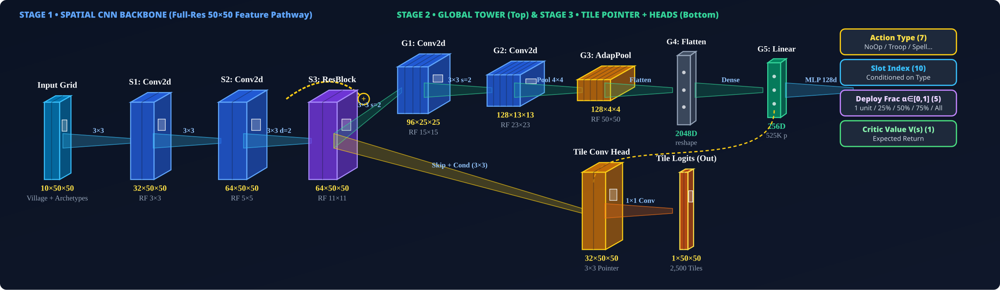
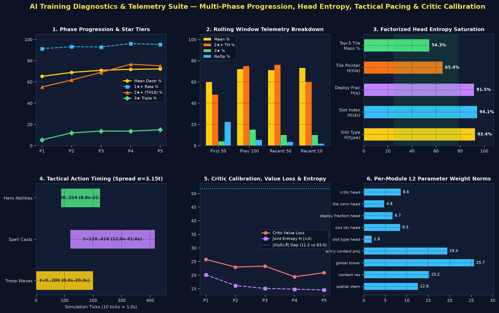

# 🤖 v1.0 — Baseline 8-Channel Single-Deploy

Back to [[00_Index_MOC|Vault Map of Content]] • View [[01_Model_Architecture_and_Training_Tracker.canvas|Interactive Obsidian Canvas]]

---

## 📌 Executive Summary & Lineage

- **Model Identifier**: `v1_baseline_8ch`
- **Architecture Version**: `v1.0`
- **Active Status**: **SUPERSEDED**
- **Total Episodes Trained**: **`30,102`** (Cumulative across **6** training sessions)
- **Peak Combat Performance**: **`100%` (3★)** (Best dense return: `+101.75`)
- **Latest Checkpoint**: `trained_models/attacker_ep30102_100pct_3star.pt`

### 🔄 Resumed Training Sessions History
| Session # | Start Ep | End Ep | Episodes Added | Checkpoint File | Peak % | Stars | Notes |
| :---: | :---: | :---: | :---: | :--- | :---: | :---: | :--- |
| **#1** | `0` | `2,400` | `+2,400` | `attacker_ep2400_86pct_2star.pt` | `86%` | `2★` | Initial training: learned perimeter drop and basic breach |
| **#2** | `2,400` | `3,824` | `+1,424` | `attacker_ep3824_86pct_2star.pt` | `86%` | `2★` | Resumed: batch size tuning (batch=8) |
| **#3** | `3,824` | `6,514` | `+2,690` | `attacker_ep6514_87pct_2star.pt` | `87%` | `2★` | Resumed: core breach funnel stabilization |
| **#4** | `6,514` | `10,208` | `+3,694` | `attacker_ep10208_97pct_2star.pt` | `97%` | `2★` | Resumed: 97% 2-star convergence |
| **#5** | `10,208` | `15,216` | `+5,008` | `attacker_ep15216_97pct_2star.pt` | `97%` | `2★` | Resumed: spell placement micro refinement |
| **#6** | `15,216` | `30,102` | `+14,886` | `attacker_ep30102_100pct_3star.pt` | `100%` | `3★` | Resumed: full 100% 3-star wipe convergence |

---

## 1. Input Observation Space

- **Spatial Observation Tensor**: `(B, 8, 50, 50)`
- **Global Army Context Vector**: `(B, 64)` (remaining troops, heroes, abilities, sieges, spells)

| Ch # | Name | Mathematical Normalization | Tactical Functional Role |
| :---: | :--- | :--- | :--- |
| `0` | **Building HP Ratio** | `hp / max_hp across footprint` | Base destruction tracking & target durability |
| `1` | **Defense DPS Threat** | `min(DPS / 1000, 1.0)` | Identifies lethal zones (Monolith, Eagle, Inferno) |
| `2` | **Town Hall 18 Mask** | `1.0 on TH18 tiles, 0.0 elsewhere` | Pinpoints Town Hall for the crucial 2nd Star |
| `3` | **Wall Integrity** | `wall_hp / max_wall_hp` | Detects closed compartments vs breached walls |
| `4` | **No-Deploy Red Zone** | `1.0 = forbidden, 0.0 = legal deploy` | Dynamic perimeter enforcing legal unit drops |
| `5` | **Friendly Ground HP** | `min(sum(HP_ground) / 5000, 1.0)` | Allied ground troop mass and density |
| `6` | **Friendly Air HP** | `min(sum(HP_air) / 5000, 1.0)` | Allied air troop mass and density |
| `7` | **Active Spell Field** | `min(remaining_ticks / 300, 1.0)` | Active Rage, Heal, Freeze, Overgrowth aura |
| `8` | **Allied Tactical Archetype** | `max phi(u) in [0, 1]` | Unit identity: Swarm (0.1) vs Ranged Core (0.6) vs Tank (0.7) vs Healer (0.81) vs Hero (0.98) |
| `9` | **Enemy Tactical Archetype** | `max phi(u) in [0, 1]` | Defending CC, Heroes, Guardians, Ground Skeletons (0.10) vs Air Skeletons (0.28) |

---

## 2. Output Policy & Action Space

The network parameterizes a factorized multi-discrete policy:

- **Head 1**: `slot_type (7)`
- **Head 2**: `slot_idx (10)`
- **Head 3**: `tile_xy (2500)`
- **Head 4**: `critic_value (1)`

---

## 3. Stacked CNN Architecture

---

## 4. Reward Shaping Function

### 🎯 Reward Formulation & Two-Phase Pacing (TH18 Combat v2.1)

Calibrated 100-point dense & milestone reward shaping balancing **Destruction + Core HP Damage** ($50\text{ pts}$) and **Victory Stars + Town Hall 18 Takedown** ($50\text{ pts}$):

$$R_t = 0.35 \cdot \Delta \%_{\text{destr}} + 15.0 \cdot \Delta \text{HP}_{\text{ratio}} + 12.0 \cdot \Delta \text{stars} + 14.0 \cdot \mathbb{I}_{\text{TH18}} + 0.08 \cdot C_{\text{funnel}} - 0.05 \cdot \mathbb{I}_{\text{invalid}}$$

- **Destruction & Core HP Damage**: $0.35\text{ pts}$ per $1\%$ destruction ($35.0\text{ pts}$ max) $+ 15.0\text{ pts}$ continuous building/core HP pool damage ($50.0\text{ pts}$ combined).
- **Stars & TH18 Takedown**: $12.0\text{ pts}$ per star ($36.0\text{ pts}$ max) $+ 14.0\text{ pts}$ dedicated milestone bonus upon destroying Town Hall 18 ($50.0\text{ pts}$ combined).
- **Two-Phase Tactical Masking & Normalized Per-Head Entropy (`reg_entropy`)**: Phase 1 deploys frontline troop waves along exterior cardinal funnels (excluding interior teaser holes) before Siege/Heroes; Phase 2 paces Spells (`t >= 40`) and Hero Abilities (`t >= 64`) with `NoOp` waiting and Town Hall spell-halo protection.

---

## 5. Main Results: Army Composition vs Reference Village Matrix

| Attack Composition | **Central Box** | **Offset Diamond** | **Anti-Hydra Ring** | **Anti-Fireball** | **Compact Teaser** | **Avg Destruction** | **3★ Rate** |
| :--- | :---: | :---: | :---: | :---: | :---: | :---: | :---: |
| **TH18 Thrower + Healer + Totem Smash** | `28% (0★)` | `33% (1★)` | `40% (1★)` | `28% (0★)` | `39% (1★)` | **33.6%** | **0.0%** |
| **TH18 Dragon Duke Charge Hydra** | `26% (0★)` | `18% (0★)` | `34% (0★)` | `36% (0★)` | `52% (2★)` | **33.2%** | **0.0%** |
| **TH18 Fireball Super Bowler & Meteor Golem Smash** | `15% (0★)` | `16% (0★)` | `32% (0★)` | `29% (0★)` | `28% (1★)` | **24.0%** | **0.0%** |
| **Base Defense Rate (Avg)** | **23.0% (0.0★)** | **22.3% (0.33★)** | **35.3% (0.33★)** | **31.0% (0.0★)** | **39.7% (1.33★)** | **Overall: 30.3%** | — |

---

## 6. Training Progress & Optimization Curves

### 🩺 AI Diagnostic Telemetry Suite (Head Entropy, Tactical Pacing & Critic Calibration)

See [[experiments/AI_Diagnostics_And_Training_Fixes|AI Training Diagnostics, Telemetry Architecture & PPO Pathology Fixes]] for the full Dual-LLM (`OpenCode Gemini 4 Argon` & `AGY Gemini 3.8 Flash`) root-cause analysis.

---

## 7. Hyperparameters & Simulation Configuration

| Hyperparameter | Value | Description |
| :--- | :--- | :--- |
| **Learning Rate (`lr`)** | `0.0003` | Adam optimizer learning rate |
| **Batch Episodes** | `4` | Trajectories collected per PPO update |
| **Minibatch Size** | `64` | SGD transition batch size |
| **PPO Epochs** | `4` | Optimization passes over collected rollout |
| **Simulation Ticks / Step** | `8` | Simulated combat duration per RL decision ($0.64\text{s}$) |
| **Discount ($\gamma$)** | `0.99` | Reward discount factor |
| **GAE ($\lambda$)** | `0.95` | Generalized Advantage Estimation smoothing |
| **Clip Coefficient** | `0.2` | PPO surrogate objective clipping range |
| **Entropy Coefficient** | `0.015` | Exploration policy entropy bonus |
| **Total Training Episodes** | **`30,102`** | **Cumulative episodes across all resumed sessions** |
