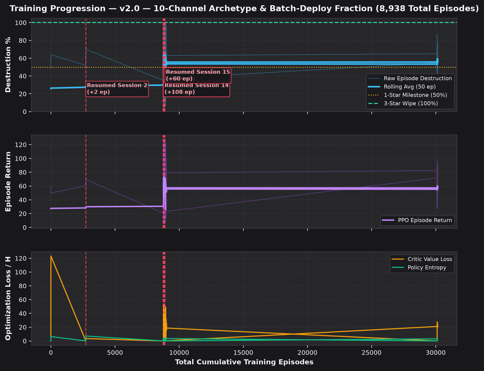

# 🤖 v2.0 — 10-Channel Archetype & Batch-Deploy Fraction

Back to [[00_Index_MOC|Vault Map of Content]] • View [[01_Model_Architecture_and_Training_Tracker.canvas|Interactive Obsidian Canvas]]

---

## 📌 Executive Summary & Lineage

- **Model Identifier**: `v2_archetype_10ch`
- **Architecture Version**: `v2.0`
- **Active Status**: **ACTIVE**
- **Total Episodes Trained**: **`8,938`** (Cumulative across **15** training sessions)
- **Peak Combat Performance**: **`100%` (3★)** (Best dense return: `+127.8575248226292`)
- **Latest Checkpoint**: `trained_models/attacker_ep8938_100pct_3star.pt`

### 🔄 Resumed Training Sessions History
| Session # | Start Ep | End Ep | Episodes Added | Checkpoint File | Peak % | Stars | Notes |
| :---: | :---: | :---: | :---: | :--- | :---: | :---: | :--- |
| **#1** | `0` | `2,724` | `+2,724` | `latest_attacker.pt` | `84%` | `2★` | Initial training: fractional wave drops (0.25..1.0) and unit archetype perception (Ch 8 & 9) |
| **#2** | `2,724` | `2,726` | `+2` | `attacker_ep2726_85pct_2star.pt` | `85%` | `2★` | Resumed training (+2 ep from latest_attacker.pt) |
| **#3** | `8,770` | `8,806` | `+36` | `attacker_ep8806_90pct_2star.pt` | `90%` | `2★` | Resumed training (+36 ep from latest_attacker.pt) |
| **#4** | `8,806` | `8,866` | `+60` | `attacker_ep8866_100pct_3star.pt` | `100%` | `3★` | Resumed training (+60 ep from latest_attacker.pt) |
| **#5** | `8,866` | `8,902` | `+36` | `attacker_ep8902_100pct_3star.pt` | `100%` | `3★` | Resumed training (+36 ep from latest_attacker.pt) |
| **#6** | `8,902` | `8,962` | `+60` | `attacker_ep8962_100pct_3star.pt` | `100%` | `3★` | Resumed training (+60 ep from latest_attacker.pt) |
| **#7** | `8,962` | `9,022` | `+60` | `attacker_ep9022_100pct_3star.pt` | `100%` | `3★` | Resumed training (+60 ep from latest_attacker.pt) |
| **#8** | `8,770` | `8,830` | `+60` | `attacker_ep8830_90pct_2star.pt` | `90%` | `2★` | Resumed training (+60 ep from latest_attacker.pt) |
| **#9** | `30,102` | `30,162` | `+60` | `attacker_ep30162_100pct_3star.pt` | `100%` | `3★` | Resumed training (+60 ep from attacker_ep30102_100pct_3star.pt) |
| **#10** | `8,770` | `8,830` | `+60` | `attacker_ep8830_94pct_2star.pt` | `94%` | `2★` | Resumed training (+60 ep from attacker_ep8770_90pct_2star.pt) |
| **#11** | `8,770` | `8,830` | `+60` | `attacker_ep8830_100pct_3star.pt` | `100%` | `3★` | Resumed training (+60 ep from attacker_ep8770_90pct_2star.pt) |
| **#12** | `8,770` | `8,830` | `+60` | `attacker_ep8830_100pct_3star.pt` | `100%` | `3★` | Resumed training (+60 ep from attacker_ep8770_90pct_2star.pt) |
| **#13** | `8,770` | `8,950` | `+180` | `attacker_ep8950_100pct_3star.pt` | `100%` | `3★` | Resumed training (+180 ep from attacker_ep8770_90pct_2star.pt) |
| **#14** | `8,770` | `8,878` | `+108` | `attacker_ep8878_100pct_3star.pt` | `98%` | `2★` | Resumed training (+108 ep from attacker_ep8770_90pct_2star.pt) |
| **#15** | `8,878` | `8,938` | `+60` | `attacker_ep8938_100pct_3star.pt` | `100%` | `3★` | Resumed training (+60 ep from latest_attacker.pt) |

---

## 1. Input Observation Space

- **Spatial Observation Tensor**: `(B, 10, 50, 50)`
- **Global Army Context Vector**: `(B, 64)` (remaining troops, heroes, abilities, sieges, spells)

| Ch # | Name | Mathematical Normalization | Tactical Functional Role |
| :---: | :--- | :--- | :--- |
| `0` | **Building HP Ratio** | `hp / max_hp across footprint` | Base destruction tracking & target durability |
| `1` | **Defense DPS Threat** | `min(DPS / 1000, 1.0)` | Identifies lethal zones (Monolith, Eagle, Inferno) |
| `2` | **Town Hall 18 Mask** | `1.0 on TH18 tiles, 0.0 elsewhere` | Pinpoints Town Hall for the crucial 2nd Star |
| `3` | **Wall Integrity** | `wall_hp / max_wall_hp` | Detects closed compartments vs breached walls |
| `4` | **No-Deploy Red Zone** | `1.0 = forbidden, 0.0 = legal deploy` | Dynamic perimeter enforcing legal unit drops |
| `5` | **Friendly Ground HP** | `min(sum(HP_ground) / 5000, 1.0)` | Allied ground troop mass and density |
| `6` | **Friendly Air HP** | `min(sum(HP_air) / 5000, 1.0)` | Allied air troop mass and density |
| `7` | **Active Spell Field** | `min(remaining_ticks / 300, 1.0)` | Active Rage, Heal, Freeze, Overgrowth aura |
| `8` | **Allied Tactical Archetype** | `max phi(u) in [0, 1]` | Unit identity: Swarm (0.1) vs Ranged Core (0.6) vs Tank (0.7) vs Healer (0.81) vs Hero (0.98) |
| `9` | **Enemy Tactical Archetype** | `max phi(u) in [0, 1]` | Defending CC, Heroes, Guardians, Ground Skeletons (0.10) vs Air Skeletons (0.28) |

---

## 2. Output Policy & Action Space

The network parameterizes a factorized multi-discrete policy:

- **Head 1**: `slot_type (7)`
- **Head 2**: `slot_idx (10)`
- **Head 3**: `deploy_fraction (5)`
- **Head 4**: `tile_xy (2500)`
- **Head 5**: `critic_value (1)`

---

## 3. Stacked CNN Architecture

---

## 4. Reward Shaping Function

### 🎯 Reward Formulation (TH18 Combat)

Balanced 50/50 weighting between **Destruction Percentage** and **Milestone Victory Stars**:

$$R_t = 0.50 \cdot \Delta \%_{\text{destr}} + 16.6667 \cdot \Delta \text{stars} - 0.05 \cdot \mathbb{I}_{\text{invalid}}$$

- **Destruction**: $0.50\text{ pts}$ per $1\%$ building destruction ($50.0\text{ pts}$ max).
- **Victory Stars**: $\frac{50.0}{3} = 16.6667\text{ pts}$ per star earned ($50.0\text{ pts}$ max for 3 stars).
- **Invalid Penalty**: $-0.05\text{ pts}$ deducted for executing illegal actions (e.g. dropping in red zone).
- **Total Wipe Return**: A complete $100\%$ 3-star wipe achieves **$100.0\text{ base reward}$**.
- **Fast-Forward Bonus**: When active attack actions are exhausted or timer reaches limit, remaining simulation ticks run to resolution and award accrued terminal rewards.

---

## 5. Main Results: Army Composition vs Reference Village Matrix

| Attack Composition | **Central Box** | **Offset Diamond** | **Anti-Hydra Ring** | **Anti-Fireball** | **Compact Teaser** | **Avg Destruction** | **3★ Rate** |
| :--- | :---: | :---: | :---: | :---: | :---: | :---: | :---: |
| **TH18 Thrower + Healer + Totem Smash** | `59% (2★)` | `76% (2★)` | `79% (2★)` | `64% (2★)` | `67% (2★)` | **69.0%** | **0.0%** |
| **TH18 Dragon Duke Charge Hydra** | `43% (0★)` | `22% (0★)` | `52% (1★)` | `22% (0★)` | `70% (2★)` | **41.8%** | **0.0%** |
| **TH18 Fireball Super Bowler & Meteor Golem Smash** | `31% (0★)` | `48% (1★)` | `70% (1★)` | `46% (0★)` | `57% (2★)` | **50.4%** | **0.0%** |
| **Base Defense Rate (Avg)** | **44.3% (0.67★)** | **48.7% (1.0★)** | **67.0% (1.33★)** | **44.0% (0.67★)** | **64.7% (2.0★)** | **Overall: 53.7%** | — |

---

## 6. Training Progress & Optimization Curves

---

## 7. Hyperparameters & Simulation Configuration

| Hyperparameter | Value | Description |
| :--- | :--- | :--- |
| **Learning Rate (`lr`)** | `0.00015` | Adam optimizer learning rate |
| **Batch Episodes** | `12` | Trajectories collected per PPO update |
| **Minibatch Size** | `128` | SGD transition batch size |
| **PPO Epochs** | `4` | Optimization passes over collected rollout |
| **Simulation Ticks / Step** | `8` | Simulated combat duration per RL decision ($0.64\text{s}$) |
| **Discount ($\gamma$)** | `0.99` | Reward discount factor |
| **GAE ($\lambda$)** | `0.95` | Generalized Advantage Estimation smoothing |
| **Clip Coefficient** | `0.2` | PPO surrogate objective clipping range |
| **Entropy Coefficient** | `0.015` | Exploration policy entropy bonus |
| **Total Training Episodes** | **`8,938`** | **Cumulative episodes across all resumed sessions** |
