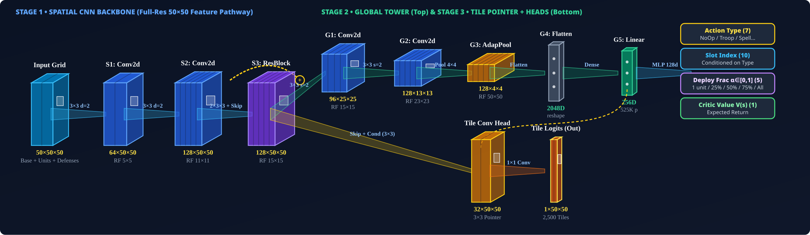
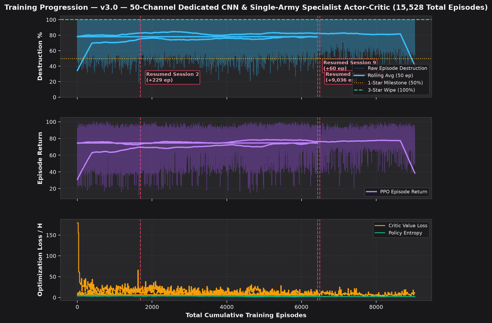
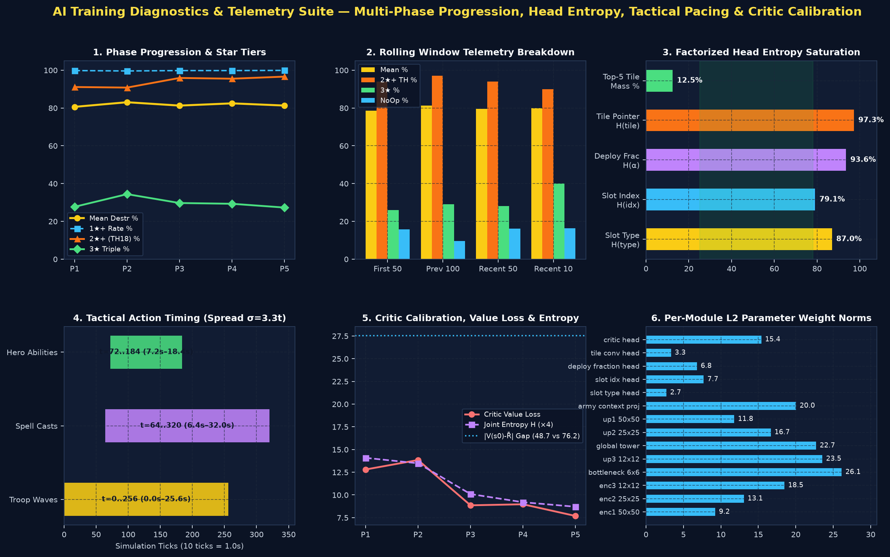

# 🤖 v3.0 — 50-Channel Dedicated CNN & Single-Army Specialist Actor-Critic

Back to [[00_Index_MOC|Vault Map of Content]] • View [[01_Model_Architecture_and_Training_Tracker.canvas|Interactive Obsidian Canvas]]

---

## 📌 Executive Summary & Single-Army Lineage

- **Model Identifier**: `v3_per_defense_31ch`
- **Architecture Version**: `v3.0` (`1,375,288` Trainable Parameters)
- **Dedicated Army Composition**: **`TH18 Thrower + Healer + Totem Smash (Meta)`** (Exported in `.pt` checkpoint metadata for testing)
- **Active Status**: **ACTIVE**
- **Total Episodes Trained**: **`15,528`** (Cumulative across **10** training sessions)
- **Peak Combat Performance**: **`100%` (3★)** (Best dense return: `+100.70336887985468`)
- **Latest Checkpoint**: `trained_models/thrower_healer_totem_smash_ep15528_100pct_3star.pt`

### 🔄 Resumed Training Sessions History
| Session # | Start Ep | End Ep | Episodes Added | Checkpoint File | Peak % | Stars | Notes |
| :---: | :---: | :---: | :---: | :--- | :---: | :---: | :--- |
| **#1** | `0` | `1,689` | `+1,689` | `thrower_healer_totem_smash_ep1689_100pct_3star.pt` | `100%` | `3★` | Initial training (1,689 ep) on TH18 Thrower + Healer + Totem Smash (Meta) |
| **#2** | `1,689` | `1,918` | `+229` | `thrower_healer_totem_smash_ep1918_100pct_3star.pt` | `100%` | `3★` | Resumed training (+229 ep from thrower_healer_totem_smash_ep1689_100pct_3star.pt) on TH18 Thrower + Healer + Totem Smash (Meta) |
| **#3** | `0` | `60` | `+60` | `thrower_healer_totem_smash_ep60_100pct_3star.pt` | `100%` | `3★` | Initial training (60 ep) on TH18 Thrower + Healer + Totem Smash (Meta) |
| **#4** | `0` | `1,000` | `+1,000` | `thrower_healer_totem_smash_ep1000_100pct_3star.pt` | `100%` | `3★` | Initial training (1,000 ep) on TH18 Thrower + Healer + Totem Smash (Meta) |
| **#5** | `0` | `4` | `+4` | `thrower_healer_totem_smash_ep4_78pct_2star.pt` | `78%` | `2★` | Initial training (4 ep) on TH18 Thrower + Healer + Totem Smash (Meta) |
| **#6** | `0` | `20` | `+20` | `thrower_healer_totem_smash_ep20_100pct_3star.pt` | `100%` | `3★` | Initial training (20 ep) on TH18 Thrower + Healer + Totem Smash (Meta) |
| **#7** | `0` | `60` | `+60` | `thrower_healer_totem_smash_ep60_100pct_3star.pt` | `100%` | `3★` | Initial training (60 ep) on TH18 Thrower + Healer + Totem Smash (Meta) |
| **#8** | `0` | `6,432` | `+6,432` | `thrower_healer_totem_smash_ep6432_100pct_3star.pt` | `100%` | `3★` | Initial training (6,432 ep) on TH18 Thrower + Healer + Totem Smash (Meta) |
| **#9** | `6,432` | `6,492` | `+60` | `thrower_healer_totem_smash_ep6492_100pct_3star.pt` | `100%` | `3★` | Resumed training (+60 ep from thrower_healer_totem_smash_ep6432_100pct_3star.pt) on TH18 Thrower + Healer + Totem Smash (Meta) |
| **#10** | `6,492` | `15,528` | `+9,036` | `thrower_healer_totem_smash_ep15528_100pct_3star.pt` | `100%` | `3★` | Resumed training (+9,036 ep from thrower_healer_totem_smash_ep6492_100pct_3star.pt) on TH18 Thrower + Healer + Totem Smash (Meta) |

---

## 1. Input Observation Space (`59 × 50 × 50` Spatial Grid + `64-D` Live Available Inventory)

- **Spatial Observation Tensor**: `(B, 59, 50, 50)` (`Ch 0..4` Base + `Ch 5..28` Dedicated Units/Heroes/Spells/Enemies + `Ch 29..49` 21 Defense Types)
- **Live Available Inventory Vector (`army_context`)**: `(B, 64)` (what troops, spells, heroes, equipment abilities, and siege machine are still available and in what remaining quantity; depleted slots zeroed out)

| Ch # | Name | Mathematical Normalization | Tactical Functional Role |
| :---: | :--- | :--- | :--- |
| `0` | **Building HP Ratio** | `hp / 11000.0 across footprint` | Base destruction tracking & target durability (Hidden Tesla masked until revealed) |
| `1` | **Defense DPS Threat** | `min(DPS / 750, 1.0)` | Identifies lethal zones (Monolith, Inferno, Scattershot, Hot Candle) |
| `2` | **Town Hall 18 Mask** | `1.0 on TH18 tiles, 0.0 elsewhere` | Pinpoints Town Hall 18 footprint for the 2nd Star |
| `3` | **Wall Integrity** | `wall_hp / max_wall_hp` | Detects closed compartments vs breached walls |
| `4` | **No-Deploy Red Zone** | `1.0 = forbidden, 0.0 = legal deploy` | Dynamic perimeter enforcing legal unit drops |
| `5` | **Thrower** | `count / 12.0 on tile` | Cluster density of primary ranged artillery (max 12 in army) |
| `6` | **Healer** | `count / 5.0 on tile` | Airborne sustain support pocket escorting main push (max 5 in army) |
| `7` | **Furnace** | `count / 2.0 on tile` | Mobile siege spawner launching continuous suicidal Firemites (max 2 in army) |
| `8` | **Druid & Bear** | `count / 1.0 on tile` | Support healer evolving into frontline Bear on demise (max 1 in army) |
| `9` | **Ice Golem** | `count / 1.0 on tile` | Frontline freeze tank immobilizing nearby defenses upon death (max 1 in army) |
| `10` | **Super Wall Breaker** | `count / 1.0 on tile` | Mega-bomb breach unit for high-value compartment entry (max 1 in army) |
| `11` | **Headhunter** | `count / 1.0 on tile` | Specialist hero-assassin dealing 4x damage to defending heroes (max 1 in army) |
| `12` | **Balloon** | `count / 1.0 on tile` | Targeted air defense-seeker and trap tester (max 1 in army) |
| `13` | **Archer** | `count / 4.0 on tile` | Light perimeter clean-up squad sniping exposed corner buildings (max 4 in army) |
| `14` | **Log Launcher (Siege)** | `1.0 on tile` | Rolling battering ram piercing wall lines toward Town Hall (max 1 in army) |
| `15` | **CC Super Yeti** | `1.0 on tile` | Core melee tank released from popped Log Launcher with Heavy Yetimites (max 1 in army) |
| `16` | **CC Super Valkyrie** | `1.0 on tile` | Core whirlwind brawler dropping lingering Rage Spell on death (max 1 in army) |
| `17` | **Barbarian King** | `1.0 on tile` | High-HP melee tank equipped with Spiky Ball & Snake Bracelet |
| `18` | **Archer Queen** | `1.0 on tile` | High-DPS ranged carry equipped with Magic Mirror & Action Figure |
| `19` | **Grand Warden** | `1.0 on tile` | Support aura hero with Eternal Tome invulnerability & Rage Gem |
| `20` | **Royal Champion** | `1.0 on tile` | Target-seeking defense assassin with Rocket Spear & Electro Boots |
| `21` | **Totem Spell (HP Ratio)** | `hp / max_hp on tile` | Summoned 1x1 lightning totem unit absorbing fire & pulsing lightning |
| `22` | **Rage Spell (Fade AoE)** | `remaining / total across AoE` | Continuous 1.0 -> 0.0 fading speed & damage boost circle |
| `23` | **Poison Spell (Fade AoE)** | `remaining / total across AoE` | Continuous 1.0 -> 0.0 fading defending CC deceleration & poison mist circle |
| `24` | **Skeleton Spell (Fade AoE)** | `remaining / total across AoE` | Continuous 1.0 -> 0.0 fading friendly skeleton distraction summon circle |
| `25` | **Enemy CC & Guardian** | `min(count / 5.0, 1.0)` | Defending Clan Castle troops (Lava Hound, Ice Golem, Headhunters) & TH18 Guardian |
| `26` | **Defending Barbarian King** | `1.0 on tile` | High-HP defending melee tank on pedestal; draws friendly melee target focus into compartment |
| `27` | **Defending Archer Queen** | `1.0 on tile` | High-DPS defending ranged carry (700+ DPS); priority target for Headhunters and Poison |
| `28` | **Defending Grand Warden** | `1.0 on tile` | Long-range defending support sniper (7.0t range) covering defense core |
| `29` | **Defending Royal Champion** | `1.0 on tile` | High-mobility defending defense assassin leaping walls to intercept attackers |
| `30` | **Defending Minion Prince** | `1.0 on tile` | Airborne defending hero sniping advancing ground troops |
| `31` | **Defending Dragon Duke** | `1.0 on tile` | Heavy aerial defending tank dealing continuous splash flame damage |
| `32` | **Enemy Ground Skeletons** | `min(count / 10.0, 1.0)` | Defending ground skeletons from skeleton traps & defending witch |
| `33` | **Enemy Air Skeletons** | `min(count / 10.0, 1.0)` | Defending air skeletons from air skeleton traps targeting air units |
| `34` | **Archer Tower** | `1.0 on alive 3×3 footprint` | Point ground+air defense (10.0t range, 145 DPS) |
| `35` | **Multi-Archer Tower** | `1.0 on alive 3×3 footprint` | 3-target merged point defense (10.0t range, 363 DPS) |
| `36` | **Ricochet Cannon** | `1.0 on alive 3×3 footprint` | 2-target bounce ground defense (9.0t range, 396 DPS) |
| `37` | **Cannon** | `1.0 on alive 3×3 footprint` | Ground point defense (9.0t range, 235 DPS) |
| `38` | **Mortar** | `1.0 on alive 3×3 footprint` | Long-range ground splash (4–11t deadzone, 56 DPS) |
| `39` | **Air Defense** | `1.0 on alive 3×3 footprint` | Anti-air high single-target rocket defense (10.0t range, 650 DPS) |
| `40` | **Wizard Tower** | `1.0 on alive 3×3 footprint` | Ground+air splash defense (7.0t range, 110 DPS) |
| `41` | **Super Wizard Tower** | `1.0 on alive 3×3 footprint` | Chain-lightning multi-target defense (8.0t range, 265 DPS) |
| `42` | **Air Sweeper** | `0.25 + 0.75 * (dir_deg / 360.0)` | Directional 105° cone air pushback (encodes presence & facing angle) |
| `43` | **Hidden Tesla** | `1.0 only when revealed, 0.0 hidden` | Revealed when enemy enters trigger range or destruction >= 51% |
| `44` | **Bomb Tower** | `1.0 on alive 3×3 footprint` | Ground splash + lethal death bomb explosion on destruction |
| `45` | **X-Bow** | `1.0 = Air & Ground, 0.5 = Ground Only` | Rapid-fire defense with mode-dependent range (11.5t A+G vs 14.0t Ground) |
| `46` | **Inferno Tower** | `1.0 = Single-Target, 0.5 = Multi-Target` | 3-stage exponential ramp beam (Single) vs 6-target scorch (Multi) |
| `47` | **Scattershot** | `1.0 on alive 3×3 footprint` | Heavy 90° cone splash behind primary target (3–10t range) |
| `48` | **Builder's Hut** | `1.0 on alive 2×2 footprint` | Weaponized turret + spawns repair builder healing nearby structures |
| `49` | **Spell Tower** | `0.25=Rage, 0.50=Poison, 0.75=Invis, 1.0=EQ` | Encodes exact equipped defensive spell tower mode |
| `50` | **Monolith** | `1.0 on alive 3×3 footprint` | Anti-tank % max-HP + flat damage priority core threat |
| `51` | **Multi-Gear Tower** | `1.0 = Long Range, 0.5 = Fast Attack` | TH18 geared defense switching between long range and fast burst |
| `52` | **Firespitter** | `0.25 + 0.75 * (dir_deg / 360.0)` | Directional 150° cone rapid piercing fireballs (encodes presence & facing angle) |
| `53` | **Revenge Tower** | `1.0 on alive 3×3 footprint` | Escalates power as 5 / 25 / 50 village buildings are destroyed |
| `54` | **Hot Candle (Crafted)** | `1.0 on alive 3×3 footprint` | Season 4 Crafted Defense firing 6 → 4 → 3 multi-target flames as it melts |
| `55` | **Clan Castle (Defense)** | `1.0 on alive 3×3 footprint` | Defensive Clan Castle garrison structure housing defending CC reinforcements |
| `56` | **Storages & Hero Hall** | `hp / max_hp across footprint` | High-HP non-offensive tanks (Gold, Elixir, Dark Elixir Storages, Hero Hall) |
| `57` | **Resource Collectors** | `hp / max_hp across footprint` | Outer perimeter resource collection structures (Gold Mines, Collectors, Drills) |
| `58` | **Utility & Other Buildings** | `hp / max_hp across footprint` | Remaining non-defensive village buildings (Army Camps, Barracks, Lab, Spell Factories, Blacksmith, etc.) |

---

## 2. Output Policy & Action Space

The network parameterizes a factorized multi-discrete policy:

- **Head 1**: `slot_type (7)`
- **Head 2**: `slot_idx (10)`
- **Head 3**: `deploy_fraction (5)`
- **Head 4**: `tile_xy (2500)`
- **Head 5**: `critic_value (1)`

---

## 3. Stacked CNN Architecture

---

## 4. Reward Shaping Function

### 🎯 Reward Formulation & Two-Phase Pacing (TH18 Combat v3.0)

Calibrated 100-point dense & milestone reward shaping balancing **Destruction + Core HP Damage** ($50\text{ pts}$) and **Victory Stars + Town Hall 18 Takedown** ($50\text{ pts}$):

$$R_t = 0.35 \cdot \Delta \%_{\text{destr}} + 15.0 \cdot \Delta \text{HP}_{\text{ratio}} + 12.0 \cdot \Delta \text{stars} + 14.0 \cdot \mathbb{I}_{\text{TH18}} + 0.08 \cdot C_{\text{funnel}} - 0.05 \cdot \mathbb{I}_{\text{invalid}}$$

- **Destruction & Core HP Damage**: $0.35\text{ pts}$ per $1\%$ destruction ($35.0\text{ pts}$ max) $+ 15.0\text{ pts}$ continuous building/core HP pool damage ($50.0\text{ pts}$ combined).
- **Stars & TH18 Takedown**: $12.0\text{ pts}$ per star ($36.0\text{ pts}$ max) $+ 14.0\text{ pts}$ dedicated milestone bonus upon destroying Town Hall 18 ($50.0\text{ pts}$ combined).
- **Two-Phase Tactical Masking & Normalized Per-Head Entropy (`reg_entropy`)**: Phase 1 deploys frontline troop waves along exterior cardinal funnels (excluding interior teaser holes) before Siege/Heroes; Phase 2 paces Spells (`t >= 40`) and Hero Abilities (`t >= 64`) with `NoOp` waiting and Town Hall spell-halo protection.

---

## 5. Main Results: Dedicated Army Composition vs. 5 Reference Villages

| Attack Composition | **Central Box** | **Offset Diamond** | **Anti-Hydra Ring** | **Anti-Fireball** | **Compact Teaser** | **Avg Destruction** | **3★ Rate** |
| :--- | :---: | :---: | :---: | :---: | :---: | :---: | :---: |
| **TH18 Thrower + Healer + Totem Smash** | `100% (3★)` | `71% (2★)` | `100% (3★)` | `88% (2★)` | `93% (2★)` | **90.4%** | **40.0%** |
| **Base Defense Rate (Avg)** | **100.0% (3.0★)** | **71.0% (2.0★)** | **100.0% (3.0★)** | **88.0% (2.0★)** | **93.0% (2.0★)** | **Overall: 90.4%** | — |

---

## 6. Training Progress & Optimization Curves

### 🩺 AI Diagnostic Telemetry Suite (Head Entropy, Tactical Pacing & Critic Calibration)

See [[experiments/AI_Diagnostics_And_Training_Fixes|AI Training Diagnostics, Telemetry Architecture & PPO Pathology Fixes]] for the full Dual-LLM (`OpenCode Gemini 4 Argon` & `AGY Gemini 3.8 Flash`) diagnostic architecture.

---

## 7. Hyperparameters & Simulation Configuration

| Hyperparameter | Value | Description |
| :--- | :--- | :--- |
| **Trained Army Composition** | `TH18 Thrower + Healer + Totem Smash (Meta)` | Single dedicated army composition per model |
| **Default Checkpoint Pattern** | `thrower_healer_totem_smash_ep{N}_{pct}pct_{stars}star.pt` | Army-prefixed checkpoint naming convention |
| **Learning Rate (`lr`)** | `0.0003` | Adam optimizer learning rate (Critic `2.5x`) |
| **Batch Episodes** | `12` | Trajectories collected per PPO update |
| **Minibatch Size** | `128` | SGD transition batch size |
| **PPO Epochs** | `4` | Optimization passes over collected rollout |
| **Simulation Ticks / Step** | `8` | Simulated combat duration per RL decision ($0.8\text{s}$) |
| **Discount ($\gamma$)** | `0.99` | Reward discount factor |
| **GAE ($\lambda$)** | `0.95` | Generalized Advantage Estimation smoothing |
| **Clip Coefficient** | `0.2` | PPO surrogate objective clipping range |
| **Entropy Coefficient** | `0.015` | Normalized per-head exploration policy entropy bonus |
| **Total Training Episodes** | **`15,528`** | **Cumulative episodes across all resumed sessions** |
